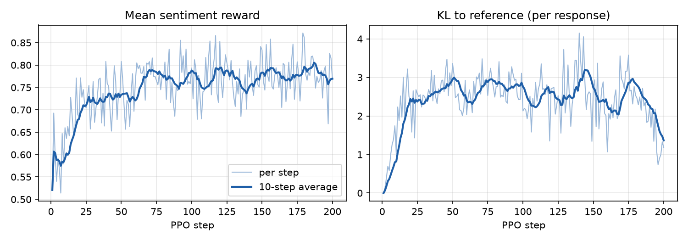

# RLHF from scratch: PPO and DPO

Fine-tunes GPT-2 to continue IMDb movie-review prompts with positive sentiment, two ways, with no RL library:

- **PPO** (online RL): sample continuations, score them with a sentiment classifier as the reward model, and update
  the policy with a clipped objective, a learned value head, GAE, and a per-token KL penalty to the starting model.
- **DPO** (offline): sample two continuations per prompt, let the reward model pick the preferred one, and train
  directly on those preference pairs, with no reward model or critic in the training loop.

## Papers

**Proximal Policy Optimization Algorithms**
John Schulman, Filip Wolski, Prafulla Dhariwal, Alec Radford, Oleg Klimov
*arXiv 2017*: https://arxiv.org/abs/1707.06347

**Direct Preference Optimization: Your Language Model is Secretly a Reward Model**
Rafael Rafailov, Archit Sharma, Eric Mitchell, Stefano Ermon, Christopher D. Manning, Chelsea Finn
*Advances in Neural Information Processing Systems 36 (NeurIPS 2023)*: https://arxiv.org/abs/2305.18290

```bibtex
@article{schulman2017proximal,
  title   = {Proximal Policy Optimization Algorithms},
  author  = {Schulman, John and Wolski, Filip and Dhariwal, Prafulla and Radford, Alec and Klimov, Oleg},
  journal = {arXiv preprint arXiv:1707.06347},
  year    = {2017}
}

@inproceedings{rafailov2023direct,
  title     = {Direct Preference Optimization: Your Language Model is Secretly a Reward Model},
  author    = {Rafailov, Rafael and Sharma, Archit and Mitchell, Eric and Ermon, Stefano and Manning, Christopher D. and Finn, Chelsea},
  booktitle = {Advances in Neural Information Processing Systems},
  volume    = {36},
  year      = {2023}
}
```

## Related papers

| Paper | Authors | Venue | Link | Used for |
|---|---|---|---|---|
| Fine-Tuning Language Models from Human Preferences | Ziegler, Stiennon, Wu, Brown, Radford, Amodei, Christiano, Irving | arXiv 2019 | [arXiv:1909.08593](https://arxiv.org/abs/1909.08593) | The task: PPO on GPT-2 with a sentiment reward and a KL penalty to the starting model |
| High-Dimensional Continuous Control Using Generalized Advantage Estimation | Schulman, Moritz, Levine, Jordan, Abbeel | ICLR 2016 | [arXiv:1506.02438](https://arxiv.org/abs/1506.02438) | GAE (`compute_gae`) |
| Training language models to follow instructions with human feedback | Ouyang et al. | NeurIPS 2022 | [arXiv:2203.02155](https://arxiv.org/abs/2203.02155) | The SFT → reward model → PPO pipeline and the per-token KL reward |

## Models and data

- Policy and reference: [lvwerra/gpt2-imdb](https://huggingface.co/lvwerra/gpt2-imdb), GPT-2 already fine-tuned on
  IMDb reviews (the SFT stage). The same setup is used in Hugging Face TRL's sentiment examples.
- Reward model: [lvwerra/distilbert-imdb](https://huggingface.co/lvwerra/distilbert-imdb), a DistilBERT sentiment
  classifier. The reward is its probability that the review is positive.
- Prompts: the first 8 tokens of reviews from [IMDb](https://huggingface.co/datasets/stanfordnlp/imdb)
  (Maas et al., ACL 2011): 12,800 training reviews for PPO, 256 for DPO pairs, and 200 test-split reviews for evaluation.

## Files

| File | What it contains |
|---|---|
| `config.py` | Hyperparameters |
| `data.py` | Tokenizer, review-prefix prompts, collator |
| `model.py` | Policy and frozen reference, value head, sentiment reward model |
| `ppo.py` | Rollouts, response log-probs, KL-shaped token rewards, values, GAE, clipped policy / value / entropy losses, PPO update and training loop |
| `dpo.py` | Synthetic preference pairs, sequence log-probs, DPO loss, update and training loop |
| `evaluate.py` | Held-out mean reward with a fixed sampling seed |
| `train_ppo.py`, `train_dpo.py` | End-to-end training and evaluation, writing `results/*.json` |
| `plot_results.py` | Reward and KL curves from the PPO run |
| `smoke_test.py` | Tiny random GPT-2 and a fake reward model: log-prob alignment, batching, GAE, clipping, PPO and DPO updates; no download |

## Run

```bash
pip install -r requirements.txt
python smoke_test.py        # quick checks, no download
python train_ppo.py         # ~25 min on a 6 GB laptop GPU (RTX 1000 Ada)
python plot_results.py      # results/ppo_training.png
python train_dpo.py         # a few minutes
```

## Results

Mean positive-sentiment reward on 200 held-out IMDb test prompts (± standard error). Every policy samples with the
same seed, so they face the same sampling noise.

| Policy | Held-out reward |
|---|---|
| Reference: GPT-2 SFT on IMDb | 0.614 ± 0.027 |
| PPO: 200 steps × 64 prompts (23 min on an RTX 1000 Ada laptop GPU) | **0.797 ± 0.022** |
| DPO: 256 preference pairs, 3 epochs | 0.731 ± 0.025 |



Reward rises over the first ~75 steps and then levels off, while the KL penalty holds the policy at about 2–3 nats
per 8-token response from the reference instead of letting it drift. DPO gets part of the gain from a fixed dataset of
256 pairs, without sampling during training or a value head. Its pairs are noisy: the mean reward gap between chosen
and rejected is only 0.23.

The first four held-out prompts (not selected):

| Prompt | Reference | PPO | DPO |
|---|---|---|---|
| "This movie was awesome. It's a" | "sub take on killer fish and its supposed" | "very realistic plane fight I've seen every" | "very touching tale of an innocent man." |
| "When the Italians and Miles O'kee" | "it's always great to see such a" | "it's always great. And it also" | "brothers converge for a rides-night," |
| "Forget what I said about Emeril" | "Lagos But better late than never," | "Emery But I think it's a" | "' HBO But better late than never," |
| "This is one of my 3 favorite movies" | "of all time from Toy Boy, which" | ". That said from the time it was" | "of all time from Toy Story 3." |

Raw numbers, per-step training stats and 10 samples per method are in [results/](results/).

**Limits.** The reward is a classifier's probability, so a policy can also learn whatever that classifier
over-rewards; responses are only 8 tokens; each method was run with one seed.

## Notes

**Log-prob alignment.** The logit at position $t$ predicts token $t+1$, so for a prompt of length $Q$ the response
tokens are scored by `logits[:, Q - 1:-1]`. `smoke_test.py` checks this against cross-entropy.

**KL-shaped reward.** Each response token gets $-\beta(\log\pi(y_t) - \log\pi_{ref}(y_t))$, and the sentiment score
is added only at the last token because it judges the whole text. GAE then spreads that final reward back over the
earlier tokens:

$$
\delta_t = r_t + \gamma V_{t+1} - V_t, \qquad A_t = \delta_t + \gamma\lambda A_{t+1}
$$

**Dropout must be off during the PPO update.** Rollout log-probs are computed with dropout off. If the update runs
with dropout on, the importance ratio $\pi_\theta / \pi_{old}$ starts away from 1 before any parameter has changed,
because of random dropout masks, and clipping then acts on noise. The update calls `policy.eval()` (gradients still
flow), and `smoke_test.py` asserts that the ratio is exactly 1 on the first minibatch, even with dropout configured.

**No entropy bonus.** With a 50k-token vocabulary and pure sampling, a 0.01 entropy bonus pushed GPT-2 toward random
tokens: in a 30-step diagnostic run, entropy rose from 4.1 to 5.5, KL to the reference climbed to about 6, and reward
stayed flat. With the bonus off, the KL penalty alone keeps the policy close to the reference.

**Batching and minibatches.** Prompts are truncated to exactly 8 tokens and responses are exactly 8 tokens, so a
whole rollout is scored in one `(batch, 16)` forward pass (`response_batches`, with a one-at-a-time fallback for mixed
lengths; the smoke test checks both give the same numbers). Each rollout of 64 is reused for 4 epochs of minibatch
updates (16 per minibatch), as in the PPO paper.

**DPO loss.** With $\beta = 0.1$:

$$
\mathcal{L}_{DPO} = -\log\sigma\left(\beta\left[\log\frac{\pi_\theta(y_w|x)}{\pi_{ref}(y_w|x)} - \log\frac{\pi_\theta(y_l|x)}{\pi_{ref}(y_l|x)}\right]\right)
$$

At initialization the policy equals the reference, so the loss is exactly $\log 2$ (checked in `smoke_test.py`).
